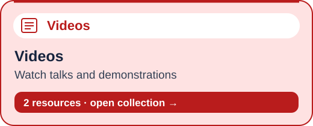
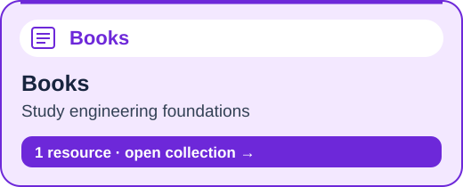
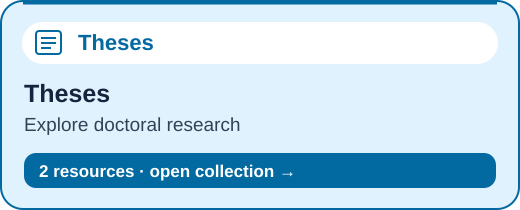
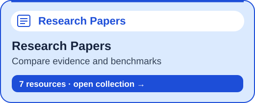
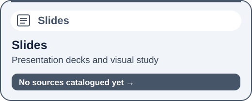
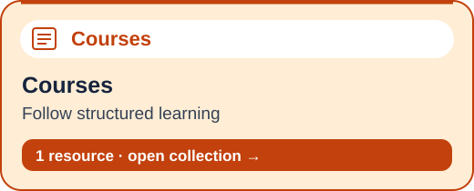
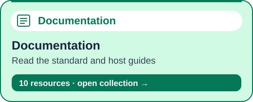
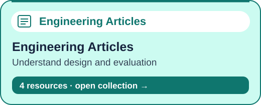
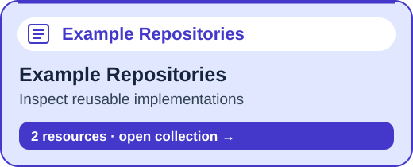
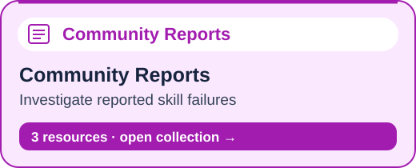

# Agent Skills Knowledge Base

**Understand skills. Design focused workflows. Measure whether they actually help.**

A practical, source-backed learning repository for ChatGPT/Codex, Claude, Kiro and Cursor. Built for people who want to develop their own dependable skills and understand why instructions are sometimes missed.

Research snapshot: **3 November 2026**. This initial edition contains **32 annotated sources** across official documentation, research papers, doctoral theses, a book, video/course resources, example repositories and community issue reports.

This is a curated knowledge base, not a claim to contain every publication or video. Full papers, paid books and video transcripts are not redistributed. Review depth and unresolved research gaps are visible in the [source catalogue](catalog/README.md).

## Learning Hub

Choose a resource card to open its collection. Category labels are navigation tags; counts come from the source catalogue.

<div>
<a href="catalog/collections.md#videos"></a>
<a href="catalog/collections.md#books"></a>
<a href="catalog/collections.md#theses"></a>
<a href="catalog/collections.md#research-papers"></a>
<a href="catalog/collections.md#slides"></a>
<a href="catalog/collections.md#courses"></a>
<a href="catalog/collections.md#documentation"></a>
<a href="catalog/collections.md#engineering-articles"></a>
<a href="catalog/collections.md#example-repositories"></a>
<a href="catalog/collections.md#community-reports"></a>
</div>

[Browse all resources](catalog/collections.md) · [Inspection depth and provenance](catalog/README.md) · [Suggested learning sequence](research/learning-resources.md#suggested-learning-sequence)

## Start Here

1. [What a skill is](docs/01-foundations.md)
2. [Platform comparison](platforms/README.md)
3. [Designing dependable skills](docs/02-design.md)
4. [Failure catalogue and remedies](docs/03-failures.md)
5. [Evaluation and release gates](docs/04-evaluation.md)
6. [Security and permission boundaries](docs/05-security.md)
7. [Using a large knowledge base without loading everything](docs/06-knowledge-retrieval.md)
8. [Worked example: a course narration workflow](docs/07-worked-example.md)
9. [Preserving the author’s intent](docs/08-author-intent.md)
10. [Enforceable acceptance architecture](docs/09-enforcement-architecture.md)
11. [Detailed testing playbook](docs/10-testing-playbook.md)
12. [Recovery and idempotency](docs/11-recovery-and-idempotency.md)
13. [Semantic rubrics](docs/12-semantic-rubrics.md)
14. [Context and skill composition](docs/13-context-and-composition.md)
15. [Release and maintenance](docs/14-release-and-maintenance.md)

## The Central Finding

A skill is reusable procedural guidance, sometimes with executable tools and references. It is not a guarantee that the model will discover it, understand every rule or execute every action correctly. Reliable workflows need explicit contracts, environment checks, independent validation and honest failure reporting.

Research is mixed. [SkillsBench v4](https://arxiv.org/abs/2602.12670v4) reports a 16.6 percentage-point average improvement with curated skills in its evaluated configurations. [SWE-Skills-Bench v2](https://arxiv.org/abs/2603.15401v2) reports a much smaller average change, from 76.6% to 76.9%, for the public software skills it studied. These are different datasets and experiments, not competing estimates of one universal success rate.

**Our engineering recommendation:** test your task, your skill, your model and your host together. Do not substitute a confidence percentage written by an assistant for measured evidence.

## Browse the Collection

| Collection | What it provides |
|---|---|
| [Source catalogue](catalog/README.md) | Links, provenance, inspection depth and limitations |
| [Research notes](research/README.md) | Findings, disagreements and applicability limits |
| [Videos, courses, books and theses](research/learning-resources.md) | A sequenced learning path and honest access notes |
| [Community reports](research/community-reports.md) | Reported symptoms, mitigations and verification status |
| [Skill design worksheet](templates/skill-design-worksheet.md) | Define a task before authoring a skill |
| [Instruction blueprint](templates/instruction-blueprint.md) | An educational outline, not an installed skill |
| [Test cases](evals/cases.json) | 40 starter scenarios for a future narration-review skill |
| [Run record](evals/run-record.example.json) | Evidence fields; deliberately contains no invented outcomes |
| [Contribution guide](CONTRIBUTING.md) | How to add evidence without copying protected works |
| [Research method](research/methodology.md) | Search scope, evidence labels and remaining gaps |

## Validate the Repository

Requires Python 3.10 or newer; no external packages or API keys.

```bash
python3 scripts/validate_kb.py
```

This checks repository structure, source metadata, local links and evaluation-case completeness. It does **not** run an AI skill, verify remote links or certify the truth of every claim.

## Executable Acceptance-Gate Demonstration

[Reference gate](examples/acceptance-gate/README.md): rejects missing checks, failed outcomes and stale artifact/contract hashes. Includes positive and negative unit tests. It is a consistency checker, not an AI skill or an authenticated production publisher.

```bash
python3 -m unittest discover -s tests -v
```

The deeper chapters add original engineering methods; the source count remains 32. No extra research is implied by the expansion. The catalogue retains its original inspection-depth labels.

## Publication Status

Public repository: [rupeshtiwari/agent-skills-knowledge-base](https://github.com/rupeshtiwari/agent-skills-knowledge-base). No LinkedIn post has been published.

## License and Attribution

Original repository prose and code are provided under [MIT](LICENSE). External works retain their original rights. Links do not grant permission to redistribute source material. This is an independent educational project, not an endorsement by any platform vendor.
