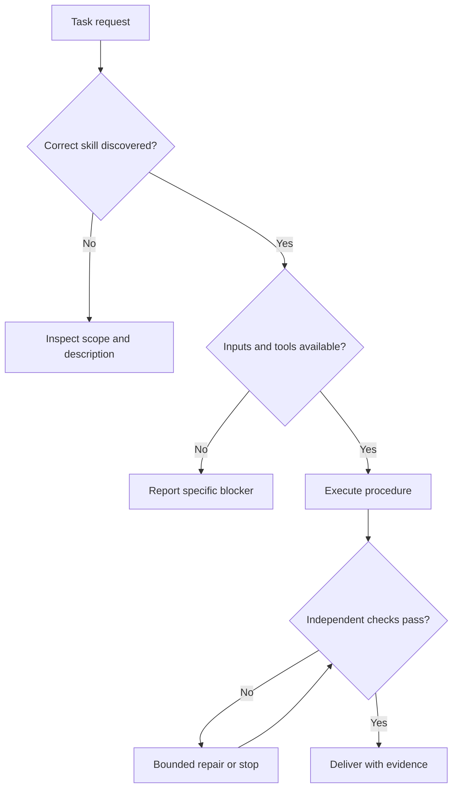

# What Is a Skill?

A skill is a reusable package describing how an agent should complete a recognizable kind of work. A typical package has a `SKILL.md` file and optional scripts, reference documents and templates. The open specification defines required metadata and layout; individual hosts add capabilities and restrictions. [S01](../catalog/README.md#s01-agent-skills-specification)

Think of a financial-report workflow: the skill explains which inputs are needed and how to reconcile them; a script performs arithmetic; an output template fixes the report structure; a validator checks totals. The model still needs the actual source files and permission to use the required tools.

## Skills and Related Concepts

| Mechanism | Primary role | What it does not establish by itself |
|---|---|---|
| Prompt | Instructions for a particular interaction | Reusable distribution and validation |
| Skill | Reusable task procedure and supporting resources | Guaranteed selection or successful execution |
| Project rules / AGENTS.md / steering | Persistent project conventions, depending on host | A complete procedure for every task |
| MCP or another tool interface | Exposes information and actions | Which business workflow to follow |
| Retrieval / RAG | Supplies selected knowledge from a collection | Authorization or correct tool execution |
| Agent harness | Runs the model/tool loop and enforces runtime constraints | Domain expertise unless supplied |
| Hook or external gate | Runs a check at a supported lifecycle event | Semantic quality beyond what the check measures |
| Fine-tuning | Changes model parameters through training | Live facts or permission to access a service |

The distinction between workflow and tools is documented in OpenAI's [plugin skills guide](https://developers.openai.com/plugins/concepts/skills). The broader comparison above is this repository's engineering synthesis, not a universal vendor taxonomy.

## Where a Failure Can Happen

For the repair branch, enforce a retry limit outside the diagram. A diagram loop is not permission for endless execution.

## Why Applying a Skill Is Not Enough

Discovery and execution are separate questions. A skill may not be surfaced in the relevant workspace. Its description may be ambiguous. It may be loaded but conflict with a higher-priority instruction. Its required file may be absent. Its script may fail. Its final answer may claim success without checking the saved artifact.

These causes require different remedies. Rewriting the description cannot fix missing credentials. Adding more prose cannot prove the generated file is valid. A strong design diagnoses the failed stage before modifying the skill.

## What Can Be Guaranteed?

A deterministic validator can enforce a bounded condition, such as rejecting a file whose word count is not 405 under a specified tokenization rule. That is a guarantee about that check, assuming its implementation and runtime are correct. It does not guarantee good teaching, accurate claims, successful publishing or correct model routing.

Use precise claims: “The release gate rejects missing evidence fields” or “18 of 20 held-out tasks passed.” Avoid “This skill never fails.”
