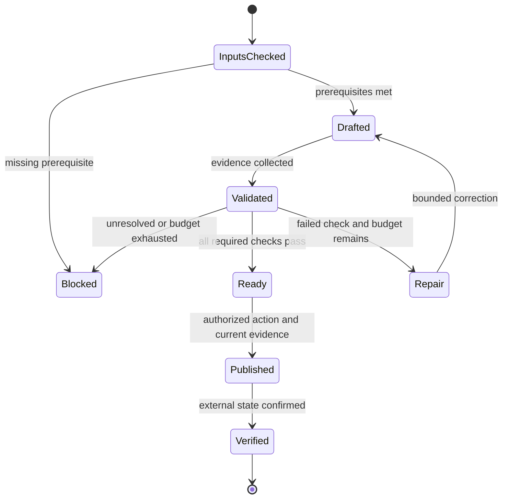

# From Instructions to Enforced Acceptance

Status: proposed architecture. The accompanying reference gate is a small local demonstration, not an integration with ChatGPT, Claude, Kiro or Cursor.

## Four Layers of Control

| Layer | Purpose | Example | Remaining weakness |
|---|---|---|---|
| Instructions | Guide decisions | Follow the approved outline | Model may miss or misinterpret it |
| Deterministic checks | Measure bounded properties | Required fields and exact count | Does not assess all meaning |
| Semantic review | Judge content against a rubric | Objective genuinely taught | Reviewer can be wrong |
| Action boundary | Prevent unacceptable release | Publisher requires valid evidence | Must be enforced on every publication path |

If the agent can bypass the publisher and upload directly, a gate attached only to the preferred publisher is not an enforcement boundary. Inventory alternative tools and permissions before claiming the release path is protected.

## Proposed State Machine

READY and PUBLISHED are distinct. A successful local validation does not imply the requested remote artifact exists. A tool's success message may still need a targeted final-state read when partial writes are possible.

## Bind Evidence to Exact Bytes

For each artifact, calculate its hash after generation. Record validator identity, version, outcome and the same artifact hash. Before release, recompute the hash. If the artifact changed, previous evidence is stale. Also bind the contract revision and relevant source revisions; an unchanged artifact can become invalid when requirements change.

Hashes establish identity, not truth. An attacker or mistaken process can produce a correctly hashed wrong file. The purpose is to prevent validation of one version being used to release another.

## Separate the Producer and the Check

For important workflows, the generator should not be able to edit the grader, mark its own tests passed or replace the authoritative contract unnoticed. Protect these in the runtime or repository permissions. In a single-agent prototype, acknowledge that separation is procedural rather than security-enforced.

The reference gate in this repository accepts an evidence JSON file. It checks consistency but does not authenticate its author. Fabricated pass records can therefore fool it. A production integration needs trusted validator execution or authenticated results and access controls. This limitation is intentional and visible.

## Fail Closed, but Explain Why

Missing mandatory evidence means HOLD. An unknown requirement ID, duplicate result or stale hash means HOLD. Optional recommendations should not block release unless the contract says so. Output exact failed requirement IDs and recovery steps.

Do not make failure reporting destructive. Preserve the draft and diagnostic report. Do not publish an invalid artifact just to avoid returning an incomplete status.

## Use Proportionate Controls

A spelling correction does not need the same pipeline as a production deployment. Classify risk by consequences, reversibility, scope and external effects. Add checks that detect meaningful errors. Measure the extra latency and remove redundant checks after evidence shows they add no value.

## Operational Checklist

Before using this architecture, identify the actual enforcement point, alternate action paths, trusted evidence producers, contract owner, allowed write destinations, concurrency controls and failure recovery procedure. Without these, the architecture is a design document rather than a deployed guarantee.
